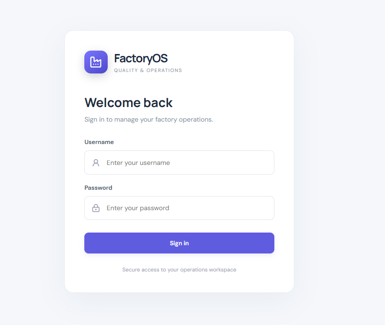
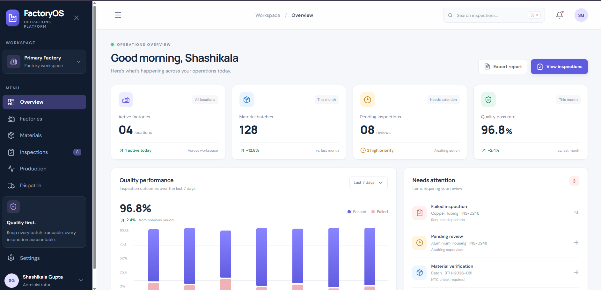
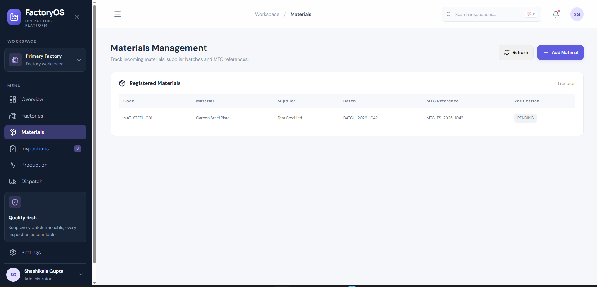
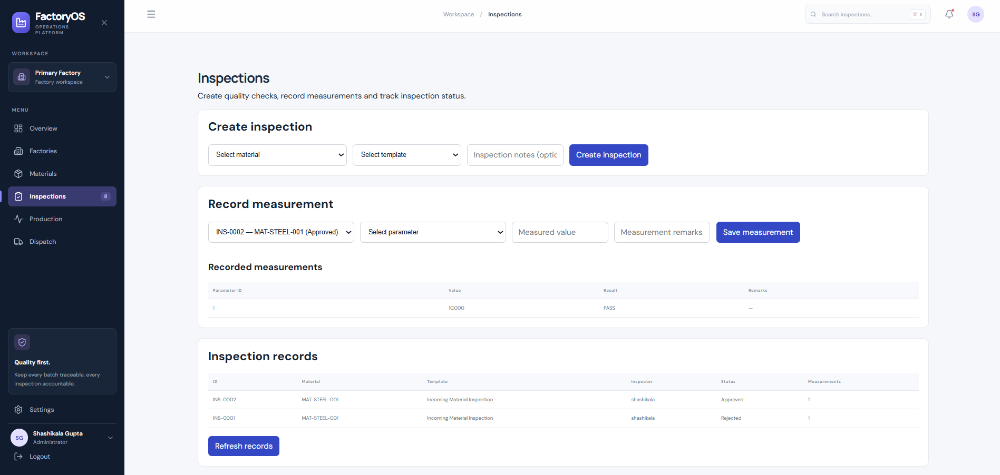
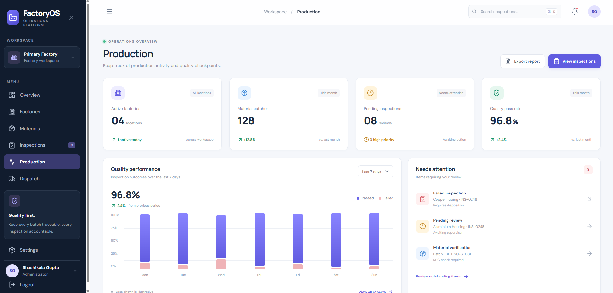
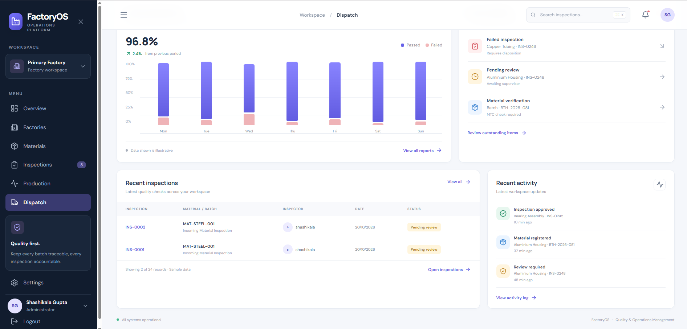
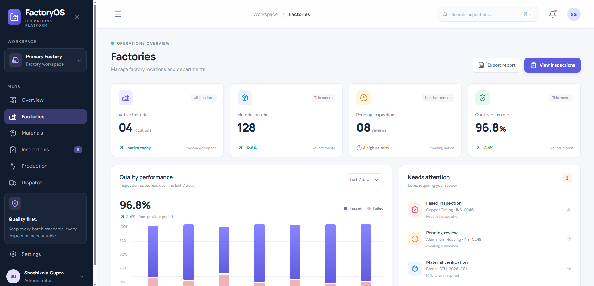
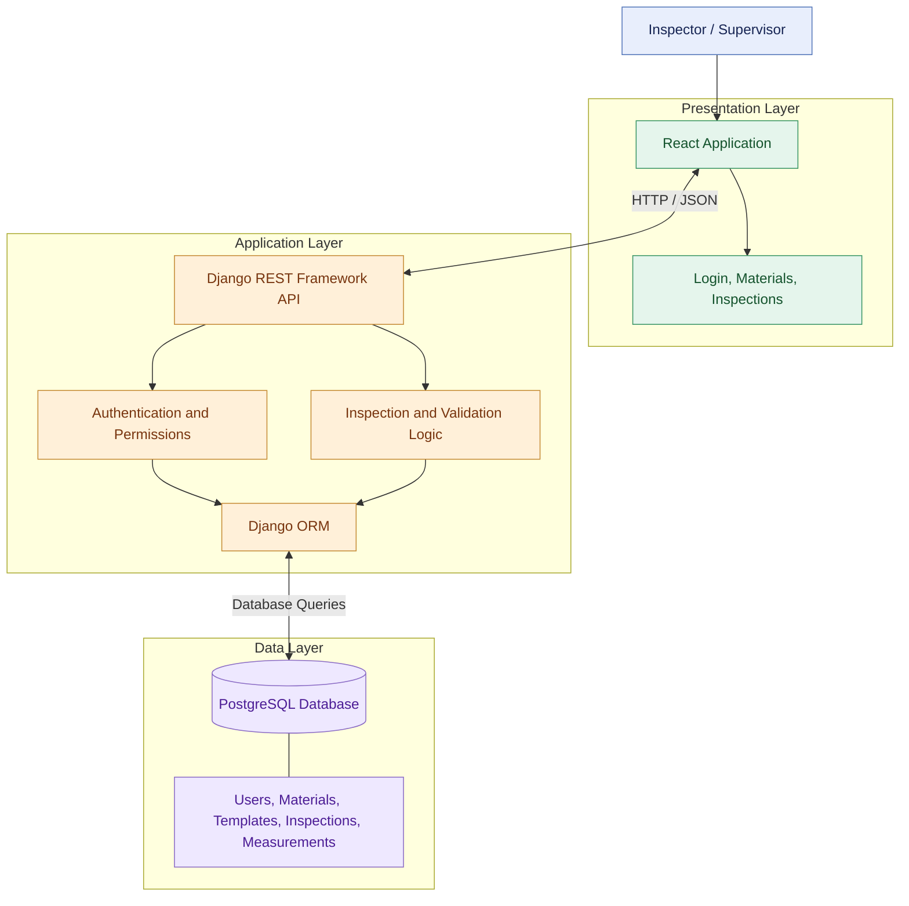

# FactoryOS — Factory Operations & Quality Management System

A web-based factory operations platform designed to organize material management, quality inspections, production visibility, dispatch operations, and factory-level information through a centralized interface.

FactoryOS combines a **React frontend**, **Django REST Framework backend**, and **PostgreSQL database** to demonstrate a structured workflow for material tracking, inspection measurements, quality evaluation, and supervisor approval.

---

## Table of Contents

- [Overview](#overview)
- [Screenshots](#screenshots)
- [Key Features](#key-features)
- [End-to-End Workflow](#end-to-end-workflow)
- [System Architecture](#system-architecture)
- [Technology Stack](#technology-stack)
- [Database and Data Flow](#database-and-data-flow)
- [Getting Started](#getting-started)
- [Application Access](#application-access)
- [Quality Validation Logic](#quality-validation-logic)
- [Project Structure](#project-structure)
- [Future Enhancements](#future-enhancements)
- [Author](#author)

---

## Overview

FactoryOS aims to provide a centralized workspace for managing factory operations and quality control activities.

The system demonstrates how material records, inspection templates, measurement results, and supervisory decisions can be organized within a single application.

### Project Objectives

- Centralize material information and inspection records.
- Record material measurements against predefined quality limits.
- Evaluate inspection results against configured acceptance criteria.
- Separate inspection activities from supervisory review.
- Store application data in a relational PostgreSQL database.
- Provide a modular interface for factory operations.

## 🎥 Project Demo

<p align="center">
  <a href="https://youtu.be/6Eywce04yB8?si=Wir4gBdQyum2i7kt">
    
  </a>
</p>

<p align="center">
  <a href="https://youtu.be/6Eywce04yB8?si=Wir4gBdQyum2i7ktD">
    
  </a>
</p>

## Screenshots

The following screenshots showcase the application's interface and workflow.

### 1. Login — Secure Application Entry

A dedicated sign-in screen provides the entry point for users accessing FactoryOS.

<p align="center">
  
</p>

### 2. Overview — Operations Dashboard

A centralized overview designed to present key factory operations and quality information at a glance.

<p align="center">
  
</p>

### 3. Materials — Material Record Management

View and manage material records, including material identifiers and descriptive information.

<p align="center">
  
</p>

### 4. Inspections — Quality Inspection Management

Create inspection records, record measurements, evaluate results, and track inspection status.

<p align="center">
  
</p>

### 5. Production — Production Operations

A production-focused interface for presenting production-related information and operational visibility.

<p align="center">
  
</p>

### 6. Dispatch — Dispatch Operations

A dedicated interface for presenting dispatch-related information and supporting operational tracking.

<p align="center">
  
</p>

### 7. Factories — Factory Information

A factory-level interface intended to organize information about factory locations or operational units.

<p align="center">
  
</p>


---

## Key Features

### Material Management

- Maintain material records with unique material codes.
- Store material names and related information.
- Retrieve material records through the backend API.

### Quality Inspection

- Create inspection records associated with materials.
- Use inspection templates and defined quality parameters.
- Record measured values against configured acceptance ranges.
- Evaluate measurements and assign inspection results.
- Track inspection progress and review status.

### Supervisor Review and Approval

- Provide a separate supervisory review step.
- Allow authorized supervisors to review eligible inspection records.
- Support approval or rejection through the inspection review workflow.
- Restrict review actions according to configured role-based permissions.

### Modular Operations Interface

- Provide a shared application layout and navigation.
- Organize operations into dedicated interface sections.
- Connect frontend views to backend API endpoints.

---

## End-to-End Workflow

The primary quality-control workflow follows these stages:

1. **Sign in:** Access the application using a configured user account.
2. **Select material:** View the material record that requires inspection.
3. **Create inspection:** Select the relevant inspection template and create an inspection record.
4. **Record measurements:** Enter the measured values for the required quality parameters.
5. **Evaluate results:** Compare measurements with the configured acceptance limits.
6. **Submit for review:** Move a completed, passing inspection into the review workflow.
7. **Supervisor decision:** An authorized supervisor reviews the record and approves or rejects it, subject to the application's validation rules.
8. **Track status:** View the inspection's current status in the application.

### Example: Incoming Material Inspection

| Field | Example value |
|---|---|
| Material code | `MAT-STEEL-001` |
| Material name | Carbon Steel Plate |
| Inspection template | Incoming Material Inspection |
| Quality parameter | Thickness |
| Minimum permitted value | `9.500` |
| Maximum permitted value | `10.500` |
| Sample measurement | `10.000` |
| Expected measurement result | `PASS` |

The sample measurement falls within the configured acceptance range. Once the required measurements are complete, the inspection can proceed to supervisory review.

---

## System Architecture

FactoryOS follows a three-layer web application architecture, separating the user interface, application logic, and persistent data storage.



### Architecture Components

**1. Presentation layer — React**

- Renders the application interface.
- Handles navigation, forms, and user interactions.
- Sends API requests to the backend.
- Displays material records, inspection measurements, and status updates.

**2. Application layer — Django REST Framework**

- Exposes HTTP API endpoints.
- Processes requests and validates submitted data.
- Applies authentication and permission rules.
- Executes inspection evaluation and review logic.
- Uses Django ORM to interact with the database.

**3. Data layer — PostgreSQL**

- Provides relational data storage.
- Persists application records.
- Supports relationships between materials, inspection templates, inspection records, and measurements.

### Request and Response Flow

1. A user performs an action in the React interface.
2. React sends an HTTP request to the Django REST Framework API.
3. Django authenticates the request and checks applicable permissions.
4. Application logic validates the request and accesses PostgreSQL through Django ORM.
5. The backend returns a response, typically in JSON format.
6. React updates the interface based on the response.

---

## Technology Stack


| Technology | Purpose |
|---|---|
| React | Frontend user interface |
| JavaScript | Client-side application logic |
| HTML5 | Application structure |
| CSS3 | Styling and layout |
| Django | Backend web framework |
| Django REST Framework | REST API development |
| Python | Backend logic and validation |
| PostgreSQL | Relational database |
| Django ORM | Database queries and model operations |
| Vite | Frontend development server and build tooling |
| Git and GitHub | Version control and source-code hosting |


<p align="center">
  <a href="https://react.dev/" target="_blank" rel="noreferrer">
    
  </a>
  <a href="https://developer.mozilla.org/en-US/docs/Web/JavaScript" target="_blank" rel="noreferrer">
    
  </a>
  <a href="https://developer.mozilla.org/en-US/docs/Web/HTML" target="_blank" rel="noreferrer">
    
  </a>
  <a href="https://developer.mozilla.org/en-US/docs/Web/CSS" target="_blank" rel="noreferrer">
    
  </a>
  <a href="https://www.python.org/" target="_blank" rel="noreferrer">
    
  </a>
  <a href="https://www.djangoproject.com/" target="_blank" rel="noreferrer">
    
  </a>
  <a href="https://www.postgresql.org/" target="_blank" rel="noreferrer">
    
  </a>
  <a href="https://vite.dev/" target="_blank" rel="noreferrer">
    
  </a>
  <a href="https://git-scm.com/" target="_blank" rel="noreferrer">
    
  </a>
  <a href="https://github.com/" target="_blank" rel="noreferrer">
    
  </a>
</p>
---

## Database and Data Flow

The application uses PostgreSQL as its primary relational database.

The core quality-control domain includes the following entities:

| Entity | Responsibility |
|---|---|
| User | Stores user account and role information |
| Material | Stores material identification and descriptive details |
| Inspection Template | Defines a reusable inspection procedure |
| Inspection Parameter | Defines a measurable quality characteristic and its limits |
| Inspection Record | Tracks an inspection associated with a material and template |
| Measurement | Stores recorded values for inspection parameters |
| Review Decision | Represents the supervisory review process, according to the implemented data model |

The Django ORM manages database interactions, while Django REST Framework exposes the operations needed by the frontend.

The exact database tables and relationships are determined by the application's Django models and migrations.

---

## Getting Started

Follow these instructions to run FactoryOS locally on a development machine.

### Prerequisites

Install the following:

- Python 3.10 or a compatible version supported by the project dependencies.
- Node.js and npm.
- PostgreSQL.
- Git.

### 1. Clone the Repository

```bash
git clone https://github.com/YOUR_GITHUB_USERNAME/FactoryOS.git
cd FactoryOS/FactoryOS
```

Adjust the repository URL and directory path to match the actual GitHub repository structure.

### 2. Set Up the Python Environment

On Windows PowerShell:

```powershell
python -m venv myenv
.\myenv\Scripts\Activate.ps1
```

Install the backend dependencies:

```powershell
python -m pip install -r requirements.txt
```

If the repository does not yet contain a `requirements.txt`, create one from the verified project environment before asking another developer to use this command.

### 3. Configure PostgreSQL

Create a PostgreSQL database and a database user with appropriate permissions.

For example, the local development configuration uses:

- Database: `factory_quality_db`
- Database user: `factory_app`

Configure the database connection in Django's settings using environment variables or the configuration method already implemented in the project.

Example environment variable names:

```text
DB_NAME=factory_quality_db
DB_USER=factory_app
DB_PASSWORD=your_local_database_password
DB_HOST=127.0.0.1
DB_PORT=5432
```

These are example configuration names; make sure they match the project's actual settings. Do not commit database passwords or other secrets to GitHub.

### 4. Apply Database Migrations

With PostgreSQL running and the Django database settings configured:

```powershell
python manage.py check
python manage.py migrate
```

Create an administrator account if needed:

```powershell
python manage.py createsuperuser
```

Use the Django management command only if an administrator account is not already available.

### 5. Start the Django Backend

```powershell
python manage.py runserver
```

The backend will normally be available at:

`http://127.0.0.1:8000/`

### 6. Set Up the React Frontend

Open another terminal:

```powershell
cd frontend
npm install
npm run dev
```

Vite will print the local frontend URL, normally:

`http://localhost:5173/`

Open that URL in your browser to access FactoryOS.

> **Development configuration:** The current development authentication flow uses HTTP Basic Authentication through the frontend's session storage. This should not be treated as a production-ready authentication implementation. Production deployment requires appropriate secure authentication, HTTPS, secret management, and deployment configuration.

---

## Application Access

FactoryOS supports distinct Inspector and Supervisor workflows.

| Role | Primary responsibility |
|---|---|
| Inspector | Manage material inspections and record measurements |
| Supervisor | Review eligible inspections and make approval decisions |

The available actions depend on the role assigned to the user and the permissions configured in the backend.

For a demonstration, use dedicated local test accounts. Never publish passwords, access tokens, or private database credentials in screenshots or repository documentation.

---

## Quality Validation Logic

Inspection measurements are evaluated against the configured minimum and maximum values.

For a parameter with lower limit \(L\), upper limit \(U\), and measured value \(x\), the measurement passes when:

\[
L \leq x \leq U
\]

For the example thickness parameter:

- Minimum: `9.500`
- Maximum: `10.500`
- Measurement: `10.000`
- Result: `PASS`

A measurement outside the allowed range fails the corresponding parameter check. The final inspection status also depends on measurement completeness and the application's workflow rules.

A passing inspection may move to `Pending review` after all required measurements have been entered. A supervisor can then review it according to the configured permissions and validation rules.

---

## Project Structure

The repository is organized around a Django backend and a React frontend.

```text
FactoryOS/
├── manage.py
├── requirements.txt
├── myenv/
├── frontend/
│   ├── src/
│   │   ├── App.jsx
│   │   ├── SignIn.jsx
│   │   ├── Materials.jsx
│   │   ├── Inspections.jsx
│   │   ├── api.js
│   │   └── index.css
│   ├── package.json
│   └── ...
├── factoryos-screenshots/
│   └── screenshots/
│       ├── login.png
│       ├── overview.png
│       ├── materials.png
│       ├── inspections.png
│       ├── production.png
│       ├── dispatch.png
│       └── factories.png
└── ...
```

The tree illustrates the main application components and proposed screenshot locations. The exact backend app names and additional files may differ in the repository.

---

## Future Enhancements

Potential next steps for FactoryOS include:

- Expand production planning and tracking functionality.
- Implement end-to-end dispatch management.
- Add factory and location management workflows.
- Introduce audit logs for inspection decisions.
- Improve automated testing for API endpoints and permissions.
- Add reporting and analytics for quality trends.
- Strengthen authentication and deployment security.
- Add automated CI/CD and production deployment configuration.

These items represent potential enhancements and should not be interpreted as completed features unless they have been implemented and tested.

---

## Author

**Shashikala Gupta**

Computer Engineering | Data Science & AI

- GitHub: [Shashikala-11](https://github.com/Shashikala-11)
- LinkedIn: [Shashikala Gupta](https://www.linkedin.com/in/shashikala-gupta/)
---

*FactoryOS — Bringing material tracking, quality inspection, and supervisory review into one structured workflow.*
